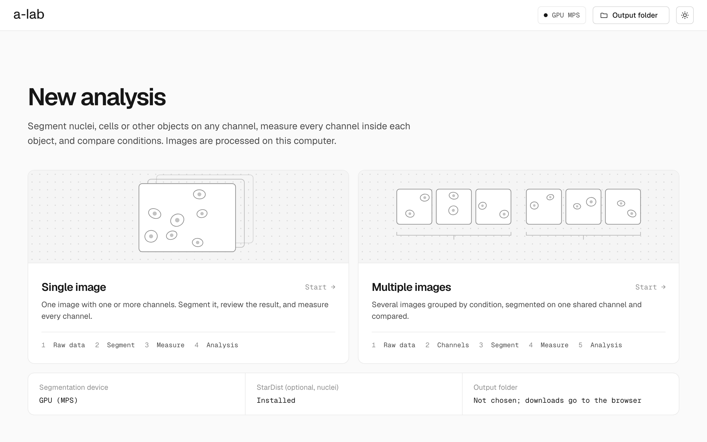

<br>

<picture>
  <source media="(prefers-color-scheme: dark)" srcset="docs/assets/wordmark-dark.png">
  
</picture>

<br><br>

Segmentation and quantification of multichannel fluorescence microscopy images, in a local web
app. From raw files to per-object measurements in one guided workflow, on your own machine.

<br>

<picture>
  <source media="(prefers-color-scheme: dark)" srcset="docs/assets/screen-home-dark.png">
  
</picture>

<br>

## Features

- **Input** — CZI, TIFF, PNG and JPEG at native bit depth. Channel names and pixel size from the
  metadata or the file names.
- **Segmentation** — Cellpose-SAM for nuclei, cells or other objects on any channel, on CUDA or
  Apple Silicon GPUs with a CPU fallback. StarDist optional for nuclei.
- **Review** — inspect and edit every mask in the browser before measuring.
- **Quantification** — 18 ImageJ-style measurements per object on every channel, sizes in µm,
  optional background subtraction, border objects excluded by default.
- **Analysis** — distributions, co-expression and positivity against a control condition.
- **Reproducibility** — every table exports with a JSON record of its parameters and the final
  masks.

## Installation

Tested with Python 3.12; 3.10 to 3.12 are supported. A GPU is optional but strongly recommended (NVIDIA CUDA or Apple
Silicon MPS). The Cellpose-SAM weights (about 1.2 GB) are downloaded to `~/.cellpose` on first
use.

```bash
git clone https://github.com/abrilcode/apoptotic-lab.git
cd apoptotic-lab
python3 -m venv .venv
source .venv/bin/activate          # Windows (PowerShell): .venv\Scripts\Activate.ps1
pip install --upgrade pip
pip install -r requirements.txt
```

On an NVIDIA GPU, install the [CUDA build of PyTorch](https://pytorch.org/get-started/locally/)
that matches the driver before `requirements.txt`. StarDist is optional:
`pip install stardist tensorflow`.

## Usage

```bash
uvicorn app:app --host 127.0.0.1 --port 8010
```

Open http://127.0.0.1:8010 and choose a flow.

| Flow | Steps |
|---|---|
| Single image | Raw data → Segment → Measure → Analysis |
| Multiple images | Raw data → Channels → Segment → Measure → Analysis |

## Outputs

| File | Contents |
|---|---|
| `measurements.csv` | One row per object and channel |
| `measurements_parameters.json` | Inputs, settings, mask edits and software versions |
| `<image>_masks.tif`, `masks.zip` | Final label masks |
| `cells_positive.csv` | Positivity per object and marker (multiple images) |
| Plots | PNG figures of each analysis view |

Details in [docs/OUTPUTS.md](docs/OUTPUTS.md).

## Agreement study

Compared with a published StarDist workflow (Waisman, 2025) on five datasets: 78 fields and
21,385 reference nuclei. Every dataset met the thresholds set in advance — Dice 0.948–0.964,
F1 0.942–0.965, count r ≥ 0.991, intensity r ≥ 0.997. This is agreement between two automatic
methods, not accuracy against manual annotation. Full method and results in
[docs/VALIDATION.md](docs/VALIDATION.md).

## Documentation

- [docs/VALIDATION.md](docs/VALIDATION.md) — agreement study
- [docs/OUTPUTS.md](docs/OUTPUTS.md) — output files, columns and parameter record
- [docs/ARCHITECTURE.md](docs/ARCHITECTURE.md) — modules and design notes
- [CHANGELOG.md](CHANGELOG.md) — changes since the thesis version ([v1.0.0](https://github.com/abrilcode/apoptotic-lab/releases/tag/v1.0.0))

## Data and privacy

Images never leave the machine. The local server keeps temporary copies in the system temp folder
(`pfcv2_upload_*`) until the OS clears it. Do not commit microscopy or patient-derived data to
this repository. apoptotic-lab is research software, not for diagnostic use.

## Citation

apoptotic-lab was developed by Abril Herrlein as the final project of the Bioengineering degree at
the Instituto Tecnológico de Buenos Aires (ITBA), supervised by Dra. María Andrea Camilletti.
Citation metadata is also available through "Cite this repository" ([CITATION.cff](CITATION.cff)).

```bibtex
@thesis{herrlein2026apoptoticlab,
  author      = {Herrlein, Abril},
  title       = {Desarrollo de una plataforma web para segmentaci{\'o}n y cuantificaci{\'o}n
                 de im{\'a}genes de fluorescencia multicanal},
  type        = {Proyecto final de carrera, Bioingenier{\'i}a},
  institution = {Instituto Tecnol{\'o}gico de Buenos Aires},
  year        = {2026}
}
```

Results produced with apoptotic-lab should also cite the segmentation model used:
Cellpose-SAM (Pachitariu, Rariden and Stringer, bioRxiv 2025,
[doi:10.1101/2025.04.28.651001](https://doi.org/10.1101/2025.04.28.651001)) and Cellpose
(Stringer et al., Nature Methods 2021,
[doi:10.1038/s41592-020-01018-x](https://doi.org/10.1038/s41592-020-01018-x)), or StarDist
(Schmidt et al., MICCAI 2018,
[doi:10.1007/978-3-030-00934-2_30](https://doi.org/10.1007/978-3-030-00934-2_30)). The reference
workflow of the agreement study is Waisman, microPublication Biology 2025,
[doi:10.17912/micropub.biology.001590](https://doi.org/10.17912/micropub.biology.001590).

## License

Released under the [MIT License](LICENSE).
